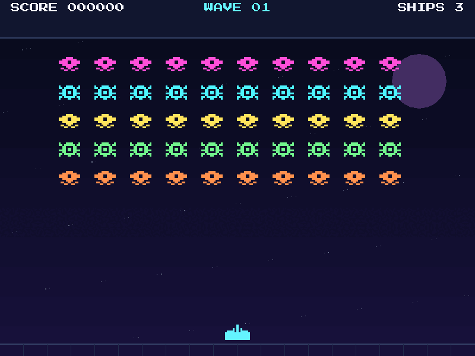

# Invader Patrol

A browser-capable, retro 2D arcade shooter written in Rust with
[Macroquad](https://macroquad.rs/).

The project began as a terminal game and has been migrated to a fixed-resolution
pixel-art renderer while keeping the simulation independent from the engine.



**Play it in the browser:** <https://leodyversemilla07.github.io/invaders/>

## Features

- Animated invaders in a formation that grows from five to seven rows per wave
- Accelerating movement, faster projectiles, and multi-invader volleys in later waves
- A "wave incoming" countdown that holds the formation still between waves
- Three lives, alien projectiles, collisions, scoring, and wave-clear bonuses
- A persistent top-five high-score table that survives a restart
- Pause, restart, mute, a title screen, and a game-over screen
- Sound effects on desktop and in the browser, with no system packages to install
- Fixed 60 Hz simulation with rendering independent of frame rate
- Native desktop and WebAssembly builds from the same Rust source
- Responsive letterboxed display and touch controls in the browser

## Controls

| Action | Keyboard |
|---|---|
| Move | Left/Right arrows or A/D |
| Fire | Space |
| Pause | P or Escape |
| Mute | M |
| Start/restart | Enter or Space |
| Quit | Q |

## Run natively

Requirements: a current stable Rust toolchain. No system audio packages or
development headers are needed.

```bash
cargo run
```

### How desktop audio works

| Platform | Backend |
|---|---|
| Linux | PulseAudio, loaded at runtime through `libpulse-simple.so.0`; falls back to `paplay`, `pw-play`, or `aplay` |
| macOS / Windows | System audio through Macroquad |
| Browser | Web Audio through Macroquad |

The Linux backend deliberately avoids ALSA: on a PulseAudio or PipeWire desktop
the hardware device is owned by the sound server, so the game talks to
PulseAudio instead. If neither PulseAudio nor a command line player is
available, the game still runs, just silently.

## Build and run in a browser

The hosted version is at <https://leodyversemilla07.github.io/invaders/>. To
run it locally:

```bash
rustup target add wasm32-unknown-unknown
./scripts/build-web.sh
python3 -m http.server 8080 --directory web
```

Open <http://localhost:8080>. The build script copies the Rust WebAssembly
binary and all game assets into `web/`.

The browser page also provides touch controls on touch-capable devices. Browsers
only allow audio to start after a user interaction, so the first sound plays
after the first key press or tap.

### WebAssembly audio compatibility patch

`vendor/quad-snd` is a copy of the `quad-snd` 0.2.8 crate with one added line
(`#[link(wasm_import_module = "env")]`). Rust 1.96 removed the implicit
`--allow-undefined` linker behaviour, which the crate relied on to import the
browser audio functions. The copy is wired in through `[patch.crates-io]` in
`Cargo.toml`; it can be removed once the fix is released upstream. See
[`vendor/quad-snd/PATCH-NOTES.md`](vendor/quad-snd/PATCH-NOTES.md).

## Development checks

```bash
cargo fmt --all -- --check
cargo clippy --all-targets -- -D warnings
cargo test
```

These same checks run automatically in CI on every push and pull request.

## Deployment

| Workflow | Trigger | Purpose |
|---|---|---|
| `.github/workflows/ci.yml` | push / PR to `main` | Format, clippy, tests, and the WebAssembly build |
| `.github/workflows/deploy.yml` | push to `main` | Builds the web bundle and publishes it to the `gh-pages` branch |

The `gh-pages` branch is the GitHub Pages source, so every push to `main`
redeploys the game to <https://leodyversemilla07.github.io/invaders/>.

## Project layout

```text
src/
├── audio.rs     # Cross-platform sound playback (PulseAudio, system, Web Audio)
├── game.rs      # Engine-independent rules, state, collisions, and unit tests
├── highscore.rs # Persistent high-score table and its platform backends
├── main.rs      # Macroquad loop, input, audio, and fixed-timestep driver
└── render.rs    # Pixel-art renderer, HUD, and screens
assets/        # Sprites, font, sounds, and third-party licenses
web/           # Browser loader and generated deployment files
scripts/       # WebAssembly build helper
vendor/        # Patched quad-snd copy for WebAssembly audio
.github/       # CI and GitHub Pages workflows
```

## Asset credits

- **Alternate Space Invaders** sprites by WaffleKilometer — CC0 1.0
- **Press Start 2P** by CodeMan38 — SIL Open Font License 1.1
- **8-Bit Sound Effect Pack (Vol. 001)** by Deva / Shades — CC0 1.0
- Macroquad runtime and WebAssembly loader — MIT OR Apache-2.0

Full source links, selected filenames, and license details are in
[`assets/ATTRIBUTION.md`](assets/ATTRIBUTION.md).

## License

The game code is released under the [MIT License](LICENSE). The art, font,
and sound effects are licensed separately, as listed above.

This is an independent game project and is not affiliated with or endorsed by
Taito Corporation. “Space Invaders” is a trademark of Taito Corporation; this
project uses its own title and independently licensed artwork.
